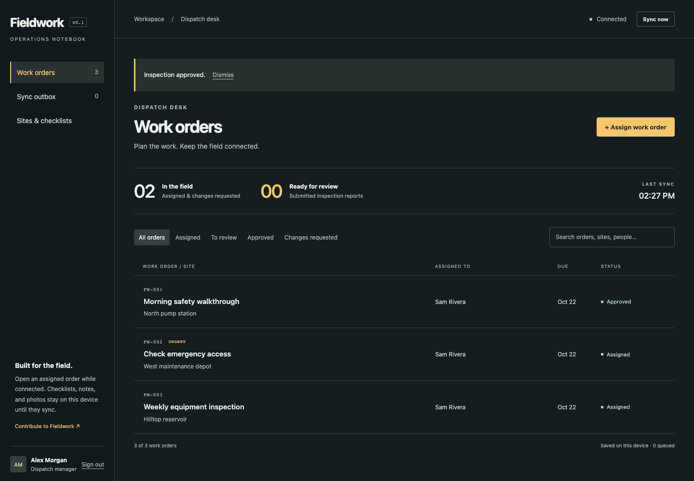

# Fieldwork

An open-source field operations platform. Assign an inspection, complete it without a connection, and review the synced report from the dispatch desk.

**v0.1 is an early foundation for a single team.** The core inspection workflow works across the web app and Expo worker app. We are building this in public and welcome contributors.



## What works today

- Manager and worker accounts with server-enforced permissions.
- Sites, reusable inspection checklists, and assigned work orders.
- Search and overdue filtering for cached web assignments. Approved work is excluded; unfinished work becomes overdue the day after its due date in the device's local time zone.
- [Due-date ranges](docs/work-order-filters.md) for planning from the cached web list, with open-ended or inclusive start/end dates.
- A [weekly planner](docs/week-planner.md) with daily workloads, offline browsing, and date-preset assignments for managers.
- A [monthly planner](docs/month-planner.md) with daily workloads, keyboard date selection, month/day exports, and offline browsing.
- [Due-date rescheduling](docs/rescheduling.md) for unfinished assignments, with manager permissions, conflict checks, and preserved worker drafts.
- [Worker reassignment](docs/reassignment.md) for unfinished web assignments, with version checks and preserved reports and local drafts.
- A [Kokonut UI work finder](docs/ui-components.md) for searching saved orders and opening workspace pages with Cmd+K or Ctrl+K, including offline.
- Shared Kokonut UI/shadcn components throughout the web workspace, including dialogs, checklist radios, form fields, status filters, cards, report tables, and draft photo attachments, with Fieldwork's charcoal-and-amber colors.
- An offline web notebook and a native Expo worker app.
- Durable checklists, notes, and photo attachments on the worker's device.
- A retryable outbox with duplicate protection and visible version conflicts.
- Manager approval or requests for changes, with an action history.
- [Report revision history](docs/report-history.md) in the web app, with saved checklist answers, photos, assignment snapshots, and review feedback.
- [CSV report exports](docs/report-export.md) for the manager's filtered work-order list, including offline exports from saved data.
- [Printable inspection reports](docs/print-reports.md) with checklist results and review details, available from saved web records offline.
- Local SQLite persistence, a typed API client, and Docker self-hosting.
- [Server search in the web app, API, and SDK](docs/server-search.md) with combined filters, incremental result loading, and individual-order caching alongside the existing offline notebook.

Maps, recurring assignments, notifications, organizations, and integrations are planned in the [roadmap](ROADMAP.md). They are not shipped features.

## Run the demo

Use **Node.js 24 LTS** and npm. No cloud accounts, API keys, or database service are needed.

```sh
git clone https://github.com/tedy69/fieldwork.git
cd fieldwork
npm ci
npm run db:seed
npm run dev
```

Open **http://localhost:5173**. The API listens on http://localhost:3001.

| Account          | Email                     | Password         |
| ---------------- | ------------------------- | ---------------- |
| Dispatch manager | `manager@fieldwork.local` | `fieldwork-demo` |
| Field worker     | `worker@fieldwork.local`  | `fieldwork-demo` |

The seed creates synthetic people and sites in a fresh local database. It refuses to overwrite an existing workspace. Use these accounts for local development only. For real accounts and deployment, follow [self-hosting](docs/self-hosting.md).

### Try offline work

1. Sign in as a worker and open an assignment while connected.
2. Complete the checklist, write a summary, and attach a photo.
3. Turn off the connection. The draft survives a page reload in a production build, or an app restart on mobile.
4. Save the report. It stays in the outbox until the server confirms it.
5. Reconnect and sync. Sign in as the manager in a different browser profile to review it.

The web service worker is enabled in production builds, not Vite development mode. To test offline reloads locally:

```sh
npm run build
npm start
# Open http://localhost:3001 and visit once while connected.
```

### Run the mobile notebook

```sh
npm run mobile
```

Open the project with a compatible Expo Go client or a development build. Enter the API URL on the sign-in screen. An iOS simulator can use `http://localhost:3001`; an Android emulator normally uses `http://10.0.2.2:3001`.

On a physical phone, start the API with `HOST=0.0.0.0 npm run dev` and use your computer's LAN address. Use HTTPS for a deployed server. See [mobile development](docs/mobile.md) for device testing and storage details.

## Contribute

Start with [CONTRIBUTING.md](CONTRIBUTING.md), then pick an [open issue](https://github.com/tedy69/fieldwork/issues) or a [good first issue](https://github.com/tedy69/fieldwork/labels/good%20first%20issue). Documentation, accessibility, translations, tests, mobile work, and integrations all matter here.

```sh
npm run check       # formatting, types, unit/API tests, web production build
npx playwright install chromium
npm run test:e2e    # real browser: offline reload, photos, sync, review, workspace setup
```

| Area                               | Directory            | Start here                                       |
| ---------------------------------- | -------------------- | ------------------------------------------------ |
| Dispatch desk and browser notebook | `apps/web`           | Work-order screens and IndexedDB adapter         |
| Native worker app                  | `apps/mobile`        | Expo app and SQLite adapter                      |
| API and database                   | `apps/api`           | `src/app.ts`, `src/store.ts`                     |
| Validated data contracts           | `packages/contracts` | Zod schemas and shared types                     |
| Typed API client                   | `packages/sdk`       | Request methods and response validation          |
| Offline engine                     | `packages/offline`   | Storage adapter and persistent outbox            |
| Tests                              | `tests`              | API permissions, sync failures, browser workflow |

Read the [architecture](docs/architecture.md), [API reference](docs/api.md), and [offline protocol](docs/offline-sync.md) before changing cross-app behavior.

## Project status

This is pre-1.0 software. It currently supports one workspace per server and one API process backed by SQLite. The checklist records are operational notes, not a certified safety or regulatory system. Device testing and release acceptance are tracked in [verification](docs/verification.md).

Local report data is not encrypted by the application. Mobile session tokens use the OS secure store; browser sessions use HttpOnly cookies. Use managed devices, protect database backups, and read [SECURITY.md](SECURITY.md) before using real operational data.

MIT licensed. Maintained by [Tedy Fazrin](https://github.com/tedy69) and contributors.
