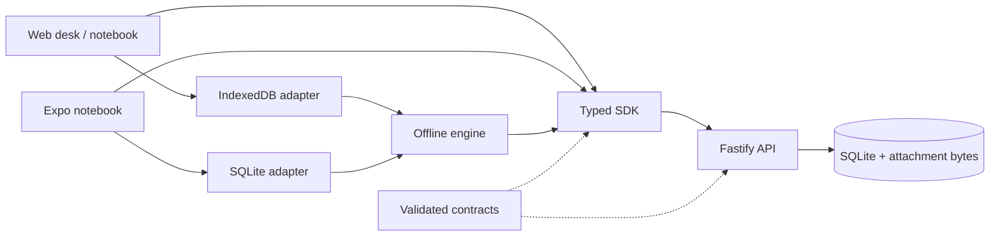

# Architecture

Fieldwork is a TypeScript npm-workspace monorepo. The initial server hosts one team's workspace in a SQLite database. The web app is both a dispatch desk and a field notebook; the Expo app is for field workers.

## Boundaries

- `packages/contracts` owns input/output schemas and shared domain types. Validate requests at the API boundary and responses in the SDK.
- `packages/sdk` owns transport, session requests, and structured errors. It accepts a base URL and optional bearer-token provider. The browser uses its same-origin HttpOnly cookie.
- `packages/offline` owns durable drafts, the outbox, serialization of writes, retries, and blocked conflicts. It accepts a storage adapter and send function; it has no browser, native, or HTTP dependency.
- `apps/api` owns authentication, authorization, state transitions, persistence, photo limits, and action history. Clients never decide whether a state transition is authorized.
- `apps/web` owns responsive web screens and its IndexedDB adapter. Work-order editing and dispatch forms are separate components.
- `apps/mobile` owns Expo screens, SecureStore session credentials, and SQLite local storage. It uses the same contracts and offline engine.

## Data and transitions

Sites and checklist templates live in the workspace catalog. Every assigned order embeds a snapshot of its site, assignee, and checklist. Creating a new template does not change old inspections.

The lifecycle is `ASSIGNED → SUBMITTED → APPROVED`, with `SUBMITTED → CHANGES_REQUESTED → SUBMITTED` for corrections. Every submission, review, or due-date change increments the order version. A request must supply the version it was based on. Managers may reschedule only `ASSIGNED` or `CHANGES_REQUESTED` work; a no-op date change does not increment the version. Writes are serialized inside a synchronous SQLite transaction, with no external work awaited inside it.

The database stores users, hashed sessions, the catalog, work orders, idempotency records, attachment bytes, and an action history. `store.ts` initializes schema version 1. Future schema changes must add an explicit migration and an upgrade test; do not silently rewrite a released schema. The action history records who performed a transition and when. Full historical report snapshots are a roadmap item.

## Offline identity

Each user's local cache has a separate key. Signing out locks the UI and leaves unsent work for that same account's next sign-in. It does not erase pending reports or migrate them to another account. API authorization is checked again on sync. Cached data is not an authorization credential.

Browser writes use an IndexedDB transaction. Native writes are serialized by the shared repository on a single app instance. The outbox is at-least-once: the server's persisted idempotency record is the duplicate boundary. Read [offline-sync.md](offline-sync.md) before changing it.

## Deployment limits

The server currently assumes a single API process and a local persistent filesystem. Do not scale it to multiple writers on a network filesystem. Multi-organization isolation, PostgreSQL, object storage, and background-job processing need their own design and migration work.

Web deployment serves the built app from the API origin. Only static assets are precached; API requests and report data are not cached by the service worker. Workers must connect once before relying on cached assignments. Native synchronization currently happens on demand and when the app returns to the foreground.
