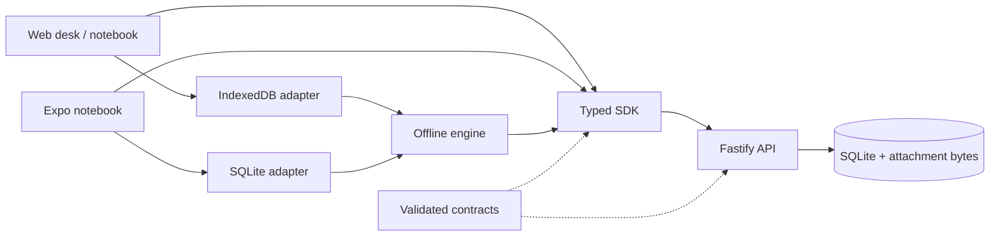

# Architecture

Fieldwork is a TypeScript npm-workspace monorepo. The initial server hosts one team's workspace in a SQLite database. The web app is both a dispatch desk and a field notebook; the Expo app is for field workers.

## Boundaries

- `packages/contracts` owns input/output schemas and shared domain types. Validate requests at the API boundary and responses in the SDK.
- `packages/sdk` owns transport, session requests, and structured errors. It accepts a base URL and optional bearer-token provider. The browser uses its same-origin HttpOnly cookie.
- `packages/offline` owns durable drafts, the outbox, serialization of writes, retries, and blocked conflicts. It accepts a storage adapter and send function; it has no browser, native, or HTTP dependency.
- `apps/api` owns authentication, authorization, state transitions, persistence, photo limits, and action history. Clients never decide whether a state transition is authorized.
- `apps/web` owns responsive web screens and its IndexedDB adapter. Work-order editing and dispatch forms are separate components.
- `apps/mobile` owns Expo screens, SecureStore session credentials, and SQLite local storage. It uses the same contracts and offline engine.

## Data and transitions

Sites and checklist templates live in the workspace catalog. Every assigned order embeds a snapshot of its site, assignee, and checklist. Creating a new template does not change old inspections.

Site snapshots may include an optional latitude/longitude pair. Older catalog, assignment, report, and offline records remain valid without it; no table migration or historical rewrite is needed. The web viewer reads account-scoped provider settings and starts external tiles only on an explicit load action. Coordinate display is independent of map availability and does not request device GPS. See [site maps](site-maps.md) for catalog permissions, snapshots, provider configuration, and test boundaries.

The lifecycle is `ASSIGNED → SUBMITTED → APPROVED`, with `SUBMITTED → CHANGES_REQUESTED → SUBMITTED` for corrections. Every submission, review, due-date change, or reassignment increments the order version. A request must supply the version it was based on. Managers may reschedule or reassign only `ASSIGNED` or `CHANGES_REQUESTED` work; a no-op date/worker change does not increment the version. Reassignment changes the embedded and indexed worker together, preserves saved reports and feedback, and moves server access to the replacement worker. Device drafts and queued reports stay with the originating account. Writes are serialized inside a synchronous SQLite transaction, with no external work awaited inside it.

The database stores users, hashed sessions, the catalog, work orders, idempotency records, attachment bytes, action history, report revisions, and recurring assignment receipts/membership. `store.ts` initializes schema 1 and applies schemas 2 and 3 in explicit transactions. Future schema changes must add an explicit migration and an upgrade test; do not silently rewrite a released schema. The action history records who performed a transition and when. Report revisions retain immutable submission/assignment snapshots, with review details attached in the review transaction. History access follows the current order assignee and manager permissions. See [report history](report-history.md) for backfill limits and stable cursor pagination.

Recurring assignments materialize a finite daily or weekly batch in one transaction. Each occurrence is an ordinary independent order. A separate manager-scoped mutation record retains the original receipt, without changing report mutation storage or cached order schemas. The web dispatch journal durably reserves a single pending batch per account before HTTP creation; IndexedDB transactions prevent competing tabs from replacing it. An expected-actor guard prevents a changed browser session from replaying it as another manager. See [recurring assignments](recurring-assignments.md) for retry and upgrade behavior.

## Offline identity

Server search is a separate read-only query through shared contracts and the SDK. It uses creation-time/ID cursor boundaries, current-assignee authorization, and explicit date filters. Results are not a complete workspace snapshot and must never be passed to `cacheOrders`, which replaces the offline collection. The existing offset list endpoint remains the full-sync source. See [server search](server-search.md).

Each user's local cache has a separate key. Signing out locks the UI and leaves unsent work for that same account's next sign-in. It does not erase pending reports or migrate them to another account. API authorization is checked again on sync. Cached data is not an authorization credential.

Browser writes use an IndexedDB transaction. Native writes are serialized by the shared repository on a single app instance. The outbox is at-least-once: the server's persisted idempotency record is the duplicate boundary. Read [offline-sync.md](offline-sync.md) before changing it.

## Deployment limits

The server currently assumes a single API process and a local persistent filesystem. Do not scale it to multiple writers on a network filesystem. Multi-organization isolation, PostgreSQL, object storage, and background-job processing need their own design and migration work.

Web deployment serves the built app from the API origin. Only static assets are precached; API requests and report data are not cached by the service worker. Workers must connect once before relying on cached assignments. Native synchronization currently happens on demand and when the app returns to the foreground.
