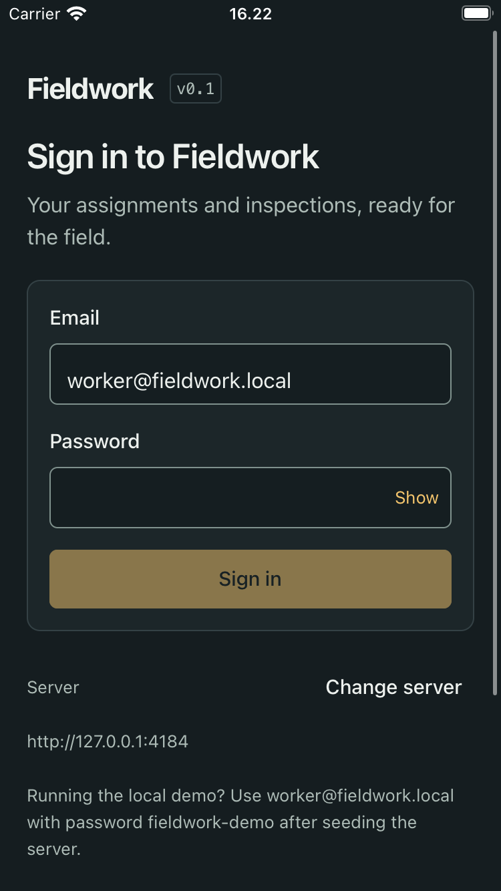
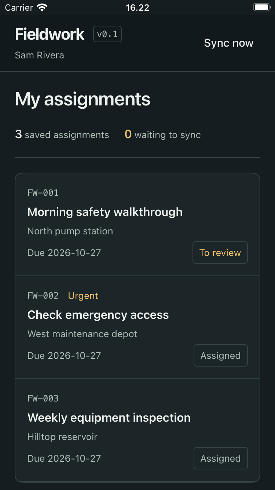
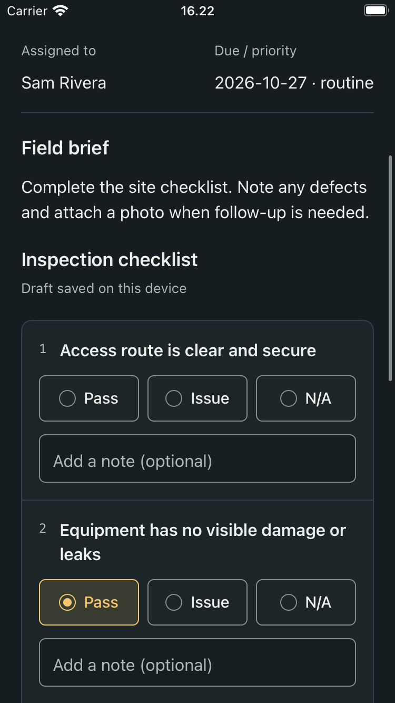

# Mobile development

`apps/mobile` is the Expo field-worker notebook. It signs in to the same API, caches assignments in SQLite, saves checklist drafts and base64 photos locally, and reuses the shared outbox. Native credentials are held in Expo SecureStore.

## Notebook UI

The app matches the web notebook's charcoal/amber palette, heading hierarchy, status wording and panel/control shapes. `apps/mobile/theme.ts` is the native token owner. `notebook-ui.tsx` provides shared Copy, Brand, Button, Field, Panel, SectionHeading, Notice, StatusBadge and AnswerChoice components. Screens arrange these components rather than defining another button or field theme. Use React Native controls here; Kokonut/shadcn DOM components belong in the web app.

Fields have visible labels, amber focus, inline password reveal and a Done editing action while focused. Email advances to Password; the password key signs in. The current server remains visible; Change server opens its editable field. Button variants (`primary`, `outline`, `ghost`) distinguish submission, photo actions and quieter navigation. Panels group the assignment ledger and ruled checklist; brief and evidence sections use the plain variant. The 26-point task title and 20-point section spacing match the clean web UI.

Actions have minimum targets of 44 points on iOS and 48 on Android. SafeAreaProvider/SafeAreaView from the SDK-compatible safe-area package own screen insets. KeyboardAvoidingView and scrollable forms keep editing and actions reachable. Opening an assignment or returning to the list resets the notebook to the top. Its header scrolls with content, stacks at larger font scales, and answer choices become full-width rows. Dynamic Type remains enabled.

These iOS simulator screenshots use seeded synthetic records:





## Repeatable native smoke test

Start an isolated, in-memory API and Metro in separate terminals:

```sh
npm exec -- tsx tests/native/design-server.ts
EXPO_PUBLIC_API_URL=http://127.0.0.1:4180 npm exec -w @fieldwork/mobile -- expo start --localhost --port 8082
```

Open `exp://localhost:8082` in SDK-compatible Expo Go on a dedicated iOS simulator. Dismiss Expo Go's first-run developer menu before running the flows against the fresh fixture. Dismiss any OS password-save prompt without saving credentials after sign-in:

```sh
maestro --device <simulator-id> test -e METRO_URL=exp://localhost:8082 tests/native/worker-sign-in.yaml
maestro --device <simulator-id> test -e METRO_URL=exp://localhost:8082 tests/native/worker-notebook.yaml
```

Start signed out for the sign-in flow. It checks server disclosure, password reveal, failed credentials, retained email and a successful retry. The notebook flow fills the seeded FW-003 checklist, checks selected answers, edits its summary, restarts Expo Go and verifies the SQLite draft and retained answer. Neither flow clears app state or the keychain. METRO_URL is supplied by the runner so a flow-local default cannot override a different test port. If localhost resolves to an address Metro is not listening on, use its actual loopback address, such as `exp://127.0.0.1:8082`.

The server script binds only to loopback, never opens a development database, and is never imported by production code. Its `/__design-test__/network` POST accepts `{ "available": false }` or `{ "available": true }` to simulate an API outage; `/__design-test__/state` reports synthetic FW-001 and its revision count for manual queue/retry checks. These endpoints do not exist in the production API. The test changes demo data, so use a dedicated simulator and fixture.

Android emulators use the host alias `10.0.2.2` instead of loopback; native acceptance below still applies to each target platform. Simulator smoke testing does not certify physical-camera behavior or store readiness.

## Start

Run the API, then `npm run mobile`. Use a compatible Expo Go client for SDK 58 or create a development build. Enter a worker account and server URL on the sign-in screen.

- iOS simulator: `http://localhost:3001`.
- Android emulator: normally `http://10.0.2.2:3001`.
- Physical phone: bind the development API with `HOST=0.0.0.0`, use the computer's LAN address, and keep both devices on the same network.
- Deployed server: HTTPS URL.

Alternatively set `EXPO_PUBLIC_API_URL` when starting Metro. This is a public server address, not a secret. Never put credentials in `EXPO_PUBLIC_*` variables.

## Native acceptance checklist

1. Sign in online and load an assigned order.
2. Answer the checklist, type notes and summary, and attach a library photo.
3. Deny camera permission; verify the explanation and library alternative. Then test taking a real photo on a physical device.
4. Disable network access to the API; close and relaunch the app. The saved assignment and draft must remain.
5. Save the report offline, reconnect, and sync once. Repeated sync taps must not duplicate it.
6. Expire the session while a report is pending; sign in with the same account and recover the queue.
7. Have another device submit or change the order; confirm a conflict is shown and the local draft remains.
8. Check large text, screen reader labels, keyboard avoidance, and Android back behavior.
9. Assign a checklist that requires a photo. Confirm its guidance appears, saving without a photo keeps the draft and shows an actionable error, and attaching/removing/re-attaching evidence works offline through restart. Submit a correction with fresh evidence after a manager requests changes.

The iOS simulator does not emulate a real camera or cellular conditions. JavaScript export, simulator smoke tests, physical-device acceptance, and store release are separate checks; record them accurately in docs/verification.md.

## Storage and synchronization

Managers can issue [worker invitation links](worker-invitations.md) from the web workspace. Open the link in a browser to choose a password, then sign in through Expo with that email, password, and the same server URL. Native invitation deep-link handling is not included.

For a forgotten worker password, ask a manager for a [password recovery link](password-recovery.md), open it in a browser, and return to Expo's normal sign-in with the new password and the same account/server. Recovery ends old server sessions and preserves local drafts and queued reports. Native deep links and physical-device recovery acceptance remain separate checks.

Managers can also [disable or reactivate workers](worker-access.md) on the web. Disabled accounts cannot sign in or sync through Expo; disconnected devices may still display saved assignments. Local drafts and queued photos remain for the same account after access is restored and the worker signs in again. Physical-device acceptance of this recovery flow remains in the device checklist.

Reports and photos use `expo-sqlite/kv-store`, scoped by user ID. SecureStore contains the session and server address. Signing out removes that credential but preserves unsent local work for the same account. Report storage is not encrypted by the app.

Synchronization runs on demand and when the app comes to the foreground. Background tasks are not implemented. Keep native-only storage, permissions, and media APIs out of `packages/offline` so web tests can exercise the same submission logic.

Type-check with `npm run typecheck`; export a platform bundle with:

```sh
npm exec -w @fieldwork/mobile -- expo export --platform ios --output-dir dist
```

Contributors are welcome to add reproducible Android and iOS automation. Use dedicated demo accounts and never clear another project's simulator data.
