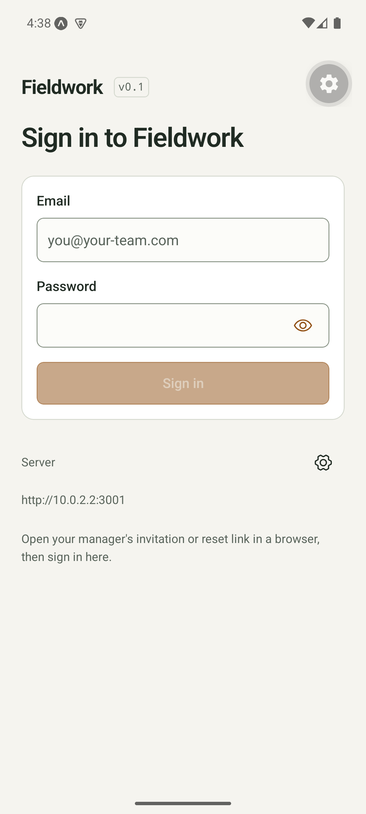
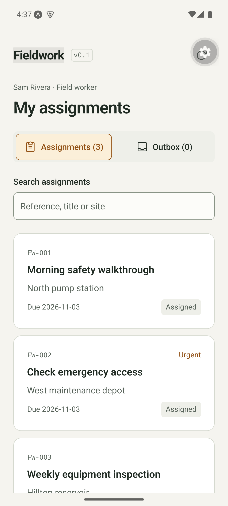
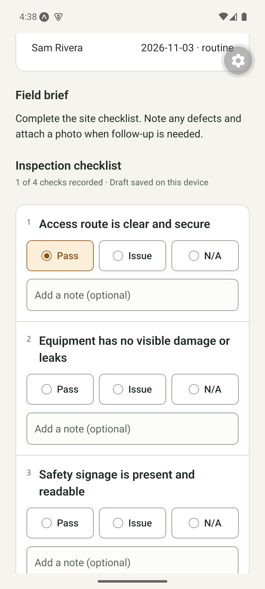

# Mobile development

`apps/mobile` is the Expo field-worker notebook. It signs in to the same API, caches assignments in SQLite, saves checklist drafts and base64 photos locally, and reuses the shared outbox. Native credentials are held in Expo SecureStore.

## Notebook UI

The app matches the web light field journal: warm paper canvas, white records, dark text, restrained amber actions, readable headings and consistent status wording. `apps/mobile/theme.ts` is the native token owner. `notebook-ui.tsx` provides shared Copy, Brand, Button, Field, Panel, SectionHeading, Notice, StatusBadge and AnswerChoice components. Screens arrange these components rather than defining another button or field theme. Use React Native controls here; Kokonut/shadcn DOM components belong in the web app.

`workspace-page.tsx` renders a virtualized assignment list and the actual report outbox. Search matches saved references, titles and sites without a network request. Search and Assignments/Outbox selection stay in the notebook controller while an inspection is open, so Back returns to the same context. Outbox records show their saved summary, photo count, local timestamp and confirmation/conflict state. Pull to refresh invokes the existing sync operation; its errors remain alongside saved work.

The tray action on the assignment list shows the number of queued reports and opens the outbox directly.

Fields have visible labels, amber focus, inline password reveal and a Done editing action while focused. Email advances to Password; the password key signs in. The current server remains visible; Change server opens its editable field. Button variants (`primary`, `outline`, `ghost`) distinguish submission, photo actions and quieter navigation; selected list destinations expose their selected state. White assignment records, a grouped metadata sheet and ruled checklist establish the reading order. The 30-point task title and 24-point section spacing match the web journal.

On first open, the notebook uses Indonesian when it is the preferred device language and English as the fallback. The language button saves an explicit choice on the device.

Familiar utility actions use named icon buttons: sync, back, server settings, sign-out, password reveal, keyboard dismissal and photo removal. Touch and hold an icon button to show its name. Assignment/Outbox navigation, photo sources and submission retain visible labels. `notebook-icons.tsx` adapts twelve regular Phosphor paths from the existing web icon version through SDK-compatible react-native-svg. Paths retain their MIT attribution in PHOSPHOR-LICENSE.txt, and the renderer's notice is in REACT-NATIVE-SVG-LICENSE.txt.

Actions have minimum targets of 48 points on both platforms. SafeAreaProvider/SafeAreaView from the SDK-compatible safe-area package own screen insets. KeyboardAvoidingView and scrollable forms keep editing and actions reachable. Opening an assignment starts the inspection at the top; returning restores list search and destination state. Its header scrolls with content, stacks at larger font scales, and answer choices become full-width rows. Dynamic Type remains enabled.

These Android emulator screenshots use seeded synthetic records:





## Repeatable native smoke test

Start an isolated, in-memory API and Metro in separate terminals:

```sh
npm exec -- tsx tests/native/design-server.ts
EXPO_PUBLIC_API_URL=http://127.0.0.1:4180 npm exec -w @fieldwork/mobile -- expo start --localhost --port 8082
```

Open `exp://localhost:8082` in SDK-compatible Expo Go on a dedicated iOS simulator. Dismiss Expo Go's first-run developer menu before running the flows against the fresh fixture. Dismiss any OS password-save prompt without saving credentials after sign-in:

```sh
maestro --device <simulator-id> test -e METRO_URL=exp://localhost:8082 tests/native/worker-sign-in.yaml
maestro --device <simulator-id> test -e METRO_URL=exp://localhost:8082 tests/native/worker-notebook.yaml
```

Start signed out for the sign-in flow. It checks server disclosure, password reveal, failed credentials, retained email and a successful retry. The notebook flow fills the seeded FW-003 checklist, checks selected answers, edits its summary, restarts Expo Go and verifies the SQLite draft and retained answer. Neither flow clears app state or the keychain. METRO_URL is supplied by the runner so a flow-local default cannot override a different test port. If localhost resolves to an address Metro is not listening on, use its actual loopback address, such as `exp://127.0.0.1:8082`.

The server script binds only to loopback, never opens a development database, and is never imported by production code. Its `/__design-test__/network` POST accepts `{ "available": false }` or `{ "available": true }` to simulate an API outage; `/__design-test__/state` reports synthetic FW-001 and its revision count for manual queue/retry checks. These endpoints do not exist in the production API. The test changes demo data, so use a dedicated simulator and fixture.

Android emulators use the host alias `10.0.2.2` instead of loopback; native acceptance below still applies to each target platform. Simulator smoke testing does not certify physical-camera behavior or store readiness.

For the Android journal flows, start Metro with `EXPO_PUBLIC_API_URL=http://10.0.2.2:4180`, run `adb -s <emulator-id> reverse tcp:8082 tcp:8082`, and use `METRO_URL=exp://127.0.0.1:8082`. Run `journal-sign-in.android.yaml` while signed out, then `journal-workspace.android.yaml` and `journal-retention.android.yaml` in that order against a fresh synthetic fixture. These flows wait for Expo Go's Development servers screen before opening the project, avoiding a cold-launch race. They preserve app data and verify actual selected radio state, search context and SQLite draft recovery.

Continue with `journal-photo.android.yaml` to attach/remove/reattach its synthetic documentation image. Disable only the fixture API via its network endpoint, then run `journal-outbox.android.yaml` to queue the completed report and verify recovery after restart. Restore the API, set the dedicated emulator's `font_scale` to `1.5`, and run `journal-reconnect-large-text.android.yaml` to exercise acknowledgement, repeated sync, the report, larger text and Android back. Restore `font_scale` to `1.0` afterward. This final flow signs out while retaining local drafts. `journal-sync.android.yaml` uses a [relative tap within Sync now](https://docs.maestro.dev/reference/commands-available/tapon) to avoid Expo Go's floating development bubble. Emulator captures include that development overlay; it is not a product control.

After sign-in, run `ADB=<adb-path> bash tests/native/icon-actions.android.sh <emulator-id>` to exercise named sync/navigation icons, touch-and-hold feedback, back navigation, selected answers, summary editing, keyboard dismissal, library photo attachment/removal and sign-out. The runner keeps assertions and actions in two Maestro flows and uses normal Android keyboard input for the synthetic summary, avoiding [Maestro's Android typing issue](https://github.com/mobile-dev-inc/Maestro/issues/2718). Expo Go's floating Tools bubble can be dragged away from the tested controls. This flow changes only dedicated synthetic drafts and media. Root `icon-native-*.png` captures are ignored by Git.

For the item photo smoke test, use a dedicated Android emulator with the same synthetic API and Metro setup. Start signed in as the fixture worker on **My assignments** with an empty outbox. Run `ADB=<adb-path> npm exec -- tsx tests/native/item-evidence.android.ts <emulator-id>`. Set `METRO_URL` or `FIELDWORK_DESIGN_TEST_PORT` if your fixture uses different defaults. The runner creates a synthetic assignment, switches the fixture API offline, and checks the photo and report across two restarts. It restores the API before reconnecting and verifies exactly one server revision with the photo linked to its question.

To check the Android notebook tools, start a fresh synthetic fixture and open **My assignments** in English as the fixture worker on a dedicated emulator with an empty outbox. Run `ADB=<adb-path> npm exec -- tsx tests/native/notebook-tools.android.ts <emulator-id>`. The runner creates an approved visit with two revisions, revokes the fixture worker's session, and checks sign-in recovery, the Approved filter, saved coordinates, older report feedback, and Android Back. It verifies that opening the saved reports leaves both server revisions intact.

For the iOS offline report smoke test, use a dedicated simulator with [a matching Expo Go build](https://docs.expo.dev/workflow/ios-simulator/). Start the synthetic fixture and Metro with `EXPO_PUBLIC_API_URL=http://127.0.0.1:4180`. Open the project, dismiss Expo Go's welcome sheet, and turn off its floating **Tools button** from the developer menu so the app's sync action is reachable. Sign in as the fixture worker, dismiss the system password prompt, and start from **My assignments** with an empty outbox.

Run `npm exec -- tsx tests/native/offline-report.ios.ts <simulator-id>`. The runner defaults to Metro on port 8082 and the fixture on 4180. Set `METRO_URL` or `FIELDWORK_DESIGN_TEST_PORT` when using different ports. It checks a retained draft and a queued report after separate restarts, restores the fixture API, and verifies one report revision after repeated sync.

Run `npm exec -- tsx tests/native/blocked-report.ios.ts <simulator-id>` from the same starting screen to test a blocked report. The runner reschedules the assignment after the worker starts a draft, verifies the outbox survives an API outage and reassignment, and checks that the original answers sync once after access is restored.

## Browse report history

Open the named history icon on an inspection with a saved report. Select a version to read its answers, summary, photos, and review feedback. The screen keeps loaded revisions visible if an older page fails, and retry uses the same page. Loaded history stays in the open screen. The inspection and its draft remain available after closing it.

Start on **Tugas saya** in Indonesian with a fresh worker session to run `npm exec -- tsx tests/native/report-history.ios.ts <simulator-id>`. The synthetic fixture verifies first-page reading, a failed second page, reconnect and retry, and return to the original draft.

When an assignment has coordinates, Expo shows them next to the site address with a map pin. The coordinates come from the saved assignment and can be selected as text while offline. Run `npm exec -- tsx tests/native/site-coordinates.ios.ts <simulator-id>` from **My assignments** in English to verify a saved coordinate pair in both languages after an API outage and a catalog edit.

## Start

The assignment list has a named funnel beside Search. Pick a status or **Overdue** to narrow the saved list, or choose **All assignments** to clear the filter while keeping the search. The filter and result count stay visible when the choices are closed. Overdue follows the device's local date and excludes approved work.

When sync requires a new session, **Sign in again** opens the sign-in form with the current server and account filled in. Drafts and queued reports remain on the device. Start with a fresh worker session in English to run `npm exec -- tsx tests/native/session-recovery.ios.ts <simulator-id>` against the synthetic fixture. The runner revokes the session through password reset, checks that the report stays in the outbox, and verifies one saved revision after signing back in.

To verify the filter, start on **My assignments** in English with the synthetic fixture cached, an empty search, and the filter closed. Run `npm exec -- tsx tests/native/assignment-status-filter.ios.ts <simulator-id>`. The runner temporarily disables the fixture API and checks the empty state, search, inspection navigation, and the language switch.

Run `npm exec -- tsx tests/native/overdue-filter.ios.ts <simulator-id>` from the same starting screen with the simulator using your computer’s time zone. The runner checks that Due today and Overdue work during an outage and show only the matching open assignments. It switches the sync notice from English to Indonesian and checks that a successful retry clears it.

Assignment rows and inspection details display the due date in the notebook language. The stored calendar day stays the same across time zones.

Run the API, then `npm run mobile`. Use a compatible Expo Go client for SDK 58 or create a development build. Enter a worker account and server URL on the sign-in screen.

- iOS simulator: `http://localhost:3001`.
- Android emulator: normally `http://10.0.2.2:3001`.
- Physical phone: bind the development API with `HOST=0.0.0.0`, use the computer's LAN address, and keep both devices on the same network.
- Deployed server: HTTPS URL.

Alternatively set `EXPO_PUBLIC_API_URL` when starting Metro. This is a public server address, not a secret. Never put credentials in `EXPO_PUBLIC_*` variables.

The sign-in screen can switch between **English** and **Bahasa Indonesia**. The choice is saved on the device and applies to sign-in, server settings, and sign-in errors. Start `sign-in-language.ios.yaml` on a signed-out synthetic simulator in English, with `METRO_URL` set to the running project. It checks the localized controls and invalid credentials, then restarts and verifies the language was saved before returning to English.

## Native acceptance checklist

1. Sign in online and load an assigned order.
2. Answer the checklist, type notes and summary, and attach a library photo.
3. Deny camera permission; verify the explanation and library alternative. Then test taking a real photo on a physical device.
4. Disable network access to the API; close and relaunch the app. The saved assignment and draft must remain.
5. Save the report offline, reconnect, and sync once. Repeated sync taps must not duplicate it.
6. Expire the session while a report is pending; sign in with the same account and recover the queue.
7. Have another device submit or change the order; confirm a conflict is shown and the local draft remains.
8. Check large text, screen reader labels, keyboard avoidance, and Android back behavior.
9. Assign a checklist that requires a photo. Confirm its guidance appears, saving without a photo keeps the draft and shows an actionable error, and attaching/removing/re-attaching evidence works offline through restart. Submit a correction with fresh evidence after a manager requests changes.

The globe beside Sync changes the language for assignments and the outbox while keeping the current search. It uses the same saved language as sign-in. Run `notebook-language.ios.yaml` from **My assignments** in English with the synthetic fixture and an empty outbox to verify search, the outbox, and restart persistence.

Inspection forms and saved reports follow the same language. For `inspection-language.ios.yaml`, assign a fresh synthetic order with a photo-required check named **Check valve** and a numeric **Pressure** question bounded from -10 to 10 bar. Start on **My assignments** in English. Set `ORDER_LABEL` to the Indonesian action label `Buka <reference>: <title>`, `READING_ID` to `inspection-reading-<question-id>`, and `METRO_URL` to the Expo project. The flow checks invalid and valid readings, a draft across restart, and the localized missing-photo message.

The iOS simulator does not emulate a real camera or cellular conditions. JavaScript export, simulator smoke tests, physical-device acceptance, and store release are separate checks; record them accurately in docs/verification.md.

## Storage and synchronization

Text and numeric questions use the existing labeled Field component and local SQLite notebook. Numeric drafts keep partial or out-of-range input as text. Save and sync inspection requires a finite reading within the assignment's inclusive limits, when set. The field shows the unit and expected range. The iOS punctuation keyboard and Android full keyboard allow the sign and decimal point. Shared submission conversion sends numbers while keeping the raw draft until acknowledgement. See [checklist fields](checklist-fields.md) for precision, units and coordinated API/web/Expo upgrades.

Managers can issue [worker invitation links](worker-invitations.md) from the web workspace. Open the link in a browser to choose a password, then sign in through Expo with that email, password, and the same server URL. Native invitation deep-link handling is not included.

For a forgotten worker password, ask a manager for a [password recovery link](password-recovery.md), open it in a browser, and return to Expo's normal sign-in with the new password and the same account/server. Recovery ends old server sessions and preserves local drafts and queued reports. Native deep links and physical-device recovery acceptance remain separate checks.

Managers can also [disable or reactivate workers](worker-access.md) on the web. Disabled accounts cannot sign in or sync through Expo; disconnected devices may still display saved assignments. Local drafts and queued photos remain for the same account after access is restored and the worker signs in again. Physical-device acceptance of this recovery flow remains in the device checklist.

Reports and photos use `expo-sqlite/kv-store`, scoped by user ID. SecureStore contains the session and server address. Signing out removes that credential but preserves unsent local work for the same account. Report storage is not encrypted by the app.

Synchronization runs on demand and when the app comes to the foreground. Background tasks are not implemented. Keep native-only storage, permissions, and media APIs out of `packages/offline` so web tests can exercise the same submission logic.

Type-check with `npm run typecheck`; export a platform bundle with:

```sh
npm exec -w @fieldwork/mobile -- expo export --platform ios --output-dir dist
```

Contributors are welcome to add reproducible Android and iOS automation. Use dedicated demo accounts and never clear another project's simulator data.
